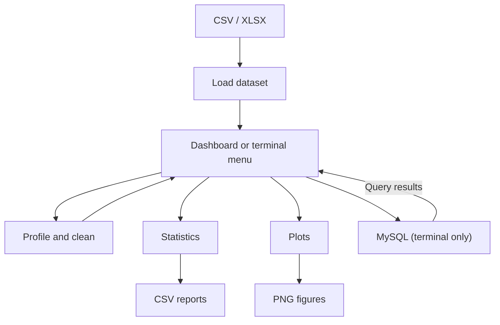

# Datacat

Datacat is a Python dashboard and command-line project for exploring tabular data. Load a CSV or Excel file, inspect its quality, clean it, run statistical summaries, and create plots through a Streamlit dashboard or an interactive terminal menu. The command-line app also offers optional MySQL support to save the current dataset as a new table and load query results for further analysis.

**Stage:** v1 core analysis workflow. The natural-language AI agent is planned for Part II.

**Stack:** Python · Pandas · NumPy · Statsmodels · Matplotlib · Seaborn · SQLAlchemy · MySQL

[Features](#features) · [Setup](#setup) · [Usage](#usage) · [MySQL](#optional-mysql-setup) · [Architecture](#module-guide) · [Roadmap](#roadmap)

## Workflow



## Features

- **Ingestion:** read `.csv` and `.xlsx` files and export processed data as CSV.
- **Profiling:** show column types, dataset dimensions, the first five rows, missing-value counts, and duplicate-row counts.
- **Cleaning:** drop rows with missing values, fill numeric missing values with column means, remove duplicates, or print potential outliers in the terminal with absolute population z-scores greater than 3.
- **Statistics:** descriptive summaries, a column mean, numeric Spearman correlations, and one-way ANOVA using a grouping column. The Python module also exposes Pearson correlation.
- **Visualization:** scatter, box, violin, and histogram plots, plus a numeric Pearson correlation heatmap.
- **Dashboard:** upload a file, navigate analysis sections, reset cleaning changes, and download CSV reports or PNG figures.
- **MySQL (terminal):** save a new table, display query results, optionally export them, and optionally use them as the current dataset.

## Setup

Install Python with virtual-environment support, then run these commands from the repository root:

```powershell
git clone https://github.com/dylanf32/Datacat.git
cd Datacat
python -m venv .venv
.\.venv\Scripts\Activate.ps1
python -m pip install -r requirements.txt
```

On macOS or Linux, activate the environment with `source .venv/bin/activate` instead. Use Python 3.12 or newer. Dependencies are not locked; Streamlit requires version 1.66.1 or newer within the 1.x series. GitHub Actions runs lint and tests with Python 3.12.

## Run the dashboard

```powershell
python -m streamlit run app.py
```

Open the local URL printed in the terminal (normally `http://localhost:8501`). Upload a `.csv` or `.xlsx` file using the sidebar. Navigate **Overview**, **Clean data**, **Statistical analysis**, **Visualization**, and **Export**. Cleaning changes remain in the current session; use **Reset to original data** to undo them. Download your results before ending the session. Uploading different file contents starts a new working dataset.

The dashboard reads uploads directly and does not require MySQL or a configured data directory. Excel uploads use the first sheet. This repository contains the runnable dashboard source; these instructions launch it locally and do not imply a hosted deployment.

## Usage

For the command-line app, place input files in `data/raw/`, then run:

```powershell
python main.py
```

The included `Order_delivery.csv` is a sample dataset. Input and processed-data paths resolve relative to the repository, so no local Windows path edits are needed. Files in `config/` remain placeholders.

Enter a filename including its extension, such as `Order_delivery.csv`, then select an option:

| Option | Action |
| --- | --- |
| 1 | Profile the current dataset |
| 2 | Clean data or inspect outliers |
| 3 | Save processed data |
| 4 | Run statistical analysis |
| 5 | Create a plot |
| 6 | Connect to MySQL |
| 0 | Exit |

Cleaning updates the dataset held in memory. Choose option 3 to write it to disk. Outlier inspection only prints flagged values; it does not remove rows. Mean filling leaves non-numeric missing values unchanged, and an entirely missing numeric column remains missing.

For an example workflow, load `Order_delivery.csv`, profile it, remove duplicates if needed, then use `Delivery_Duration_Minutes` for a histogram or `City` and `Delivery_Duration_Minutes` for one-way ANOVA. ANOVA results require appropriate assumptions and interpretation; the application does not check those assumptions automatically.

In the terminal app, plot windows open before the save prompt. Close the plot window to return to the menu and choose whether to save it.

### Terminal exports

| Output | Location |
| --- | --- |
| Processed dataset | `data/processed_data/`, as `<dataset>.csv` |
| Summary, correlation, or ANOVA table | `outputs/tables/<dataset>_<analysis>.csv` |
| Query results | `outputs/tables/<dataset>_query.csv` |
| Plot | `outputs/figures/<dataset>_<plot>.png` |

The app creates the output directories automatically. Repeating a save with the same dataset and output type overwrites the previous file. A column mean is printed only; it has no export prompt. Using SQL results as the current dataset keeps the original dataset name for subsequent exports.

## Optional MySQL setup

The database module connects to `localhost:3306` and expects an existing database named `datacat`. Install and start MySQL separately, then create the database using an account with the required privileges:

```sql
CREATE DATABASE IF NOT EXISTS datacat;
```

Select option 6 and enter your MySQL username and password. The password prompt hides input. Host, port, and database name are configured directly in [Datacat/database.py](Datacat/database.py).

Saving uses `if_exists="fail"`, so an existing table is not replaced. To read a table you created, choose the query option and enter, for example:

```sql
SELECT * FROM orders LIMIT 10;
```

The menu asks for a SELECT query, but the module passes the supplied SQL to SQLAlchemy without enforcing read-only statements. Use a database account with permissions appropriate to your work. Database connection and SQL errors may terminate the app because the menu does not catch all database exceptions.

## Repository layout

```text
Datacat/                 Reusable ingestion, profiling, cleaning, statistics,
                         visualization, and database modules
main.py                  Interactive menu and dataset state
data/raw/                Input data and the example CSV
data/processed_data/     Intended processed-data directory
app.py                   Streamlit dashboard and browser downloads
notebooks/               Placeholder notebooks for future exploration
config/                  Configuration placeholders
database/                SQL project and connection placeholder
image.png                Existing project image
```

The `.sqlproj` file targets SQL Server tooling; it is not a MySQL initialization script and is not used by `main.py`. Statistical and plotting dependencies are imported when their menu options are selected, as are the database dependencies. The application reads Excel's default first sheet and does not offer sheet selection or automatic date parsing for CSV files.

## Module guide

| File | Responsibility |
| --- | --- |
| [app.py](app.py) | Dashboard upload, session state, navigation, and downloads |
| [main.py](main.py) | Interactive menu, dataset state, and exports |
| [Datacat/ingestion.py](Datacat/ingestion.py) | CSV/XLSX loading and processed CSV export |
| [Datacat/profiling.py](Datacat/profiling.py) | Dataset overview, missing values, and duplicates |
| [Datacat/cleaning.py](Datacat/cleaning.py) | Missing-value handling, deduplication, and outlier inspection |
| [Datacat/statistic.py](Datacat/statistic.py) | Summary, mean, Pearson/Spearman correlation, and one-way ANOVA |
| [Datacat/visualization.py](Datacat/visualization.py) | Scatter, box, violin, histogram, and heatmap plots |
| [Datacat/database.py](Datacat/database.py) | MySQL connections, table writes, and query results |

## Development checks

```powershell
python -m pip install pytest flake8
python -m pytest
python -m flake8 . --exclude=.venv,venv --select=E9,F63,F7,F82 --show-source
```

The tests exercise dashboard navigation, cleaning/reset, statistics, plots, file ingestion, and the terminal menu. They do not require a MySQL server; live MySQL connectivity is not covered. `Datacat/validation.py` and the remaining notebooks are placeholders, not implemented validation features.

## Roadmap

The current application uses explicit dashboard controls and terminal menu choices. Future work includes a natural-language agent that calls these existing tools, followed by machine-learning capabilities. Q-Q plots, t-tests, chi-square tests, and standalone regression analysis are future extensions rather than current menu features.

## Author

Developed by [Dylan Ferrer](https://github.com/dylanf32) as a data science portfolio project.
